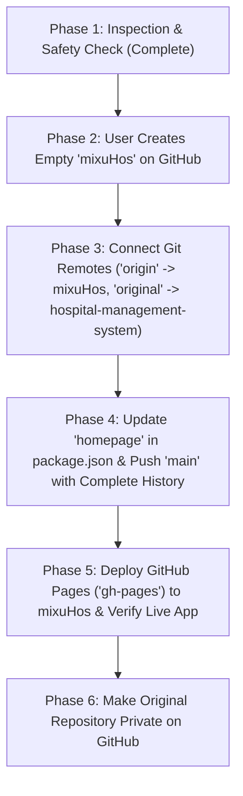

# GITHUB REPOSITORY MIGRATION REPORT: `hospital-management-system` -> `mixuHos`

**Project:** Hospital Management / EMR System  
**Current Repository:** `https://github.com/Hiimesh0/hospital-management-system.git`  
**Target Repository:** `https://github.com/Hiimesh0/mixuHos.git`  
**Deployment Platform:** GitHub Pages  
**Date:** November 5, 2026  
**Document Version:** 1.0.0  
**Status:** Phase 1 Complete (Inspection & Readiness Verified)  

---

## 1. Phase 1 — Current Git & Deployment Inspection Findings

### 1.1 Local Workspace & Repository Structure
- **Workspace Root:** `c:\Users\kanth\Desktop\Project_1`
- **Active Git Repository:** `c:\Users\kanth\Desktop\Project_1\frontend\.git`
  - *Note:* The version-controlled application repository is housed in `frontend/`, which contains the entire frontend React/TypeScript source code, documentation, test suites, and GitHub Pages deployment configuration.
  - The root workspace also contains the local Python/Django backend (`backend/`), screenshots (`SS/`), and design assets.

### 1.2 Git Remote & Branch Configuration
- **Active Branch:** `main`
- **Remote `origin`:** `https://github.com/Hiimesh0/hospital-management-system.git`
  - Fetch URL: `https://github.com/Hiimesh0/hospital-management-system.git`
  - Push URL: `https://github.com/Hiimesh0/hospital-management-system.git`
- **Tracking Branches:**
  - `origin/main` (Production application code)
  - `origin/gh-pages` (Built static bundle for live GitHub Pages deployment)
- **Local State:** Working tree clean on `main`.

### 1.3 Commit History Preservation
The repository contains full commit history spanning all project development phases:
1. `a48ecbe` — *feat(echo-report): implement complete 2D echocardiography reporting module with backend JSON storage*
2. `9999f96` — *feat(sidebar): reorder navigation by verified working modules with section grouping*
3. `932b2e1` — *Optimize Patient Registration UI, history visibility, clean sidebar logo, subtle watermark, and split-screen login*
4. `06dc08f` — *feat: implement Doctor Master, Medicine Master, and Report Template modules*
5. `df81866` — *feat: combine patient registration and patient history into one unified workflow*
6. `cc8b663` — *feat: remove duplicate sidebar, add bill discount details, and fix invoice numbering*
7. `5792563` — *feat(patient-registration): enter key navigation, sticky action sidebar, record locking, and dynamic billing*
8. `a4854e8` — *feat: centralize hospital details (XYZ) and implement A4 patient sticker printing*
9. `4ebaa33` — *feat(patient-registration): add Bill button with printable Bill Cum Receipt PDF matching Bill.jpeg*
10. `bed3a19` — *fix(scanner-ui): remove diagnostic box and make patient lookup toolbar responsive*

### 1.4 Deployment Platform & Source
- **Platform:** GitHub Pages
- **Current Live URL:** `https://Hiimesh0.github.io/hospital-management-system/`
- **Deployment Script:** `npm run deploy` (`gh-pages -d dist`)
- **Package Configuration:** `"homepage": "https://Hiimesh0.github.io/hospital-management-system"`

### 1.5 Security & Sensitive Files Audit
- **Environment Files (`.env`):** None present in workspace.
- **Credentials & API Keys:** No hardcoded private API keys, database credentials, or secret tokens.
- **Patient Information:** Storage files (`backend/data/patients.json`) contain only synthetic demo/test records (`TestBillPatient`, `TestBanner`) created during development. No real patient data exists in the repository.
- **Ignored Directories:** `node_modules/`, `dist/`, `dist-ssr/`, `logs/`, `.vercel/` are excluded.
- **Security Improvement:** Added explicit `.env*` exclusion patterns into `.gitignore`.

### 1.6 Target Repository Check
- Target URL: `https://github.com/Hiimesh0/mixuHos.git`
- Verification check via `git ls-remote`:
  ```
  remote: Repository not found.
  fatal: repository 'https://github.com/Hiimesh0/mixuHos.git/' not found
  ```
- **Finding:** The repository `mixuHos` does not yet exist under GitHub account `Hiimesh0`.

---

## 2. Migration Execution Plan



### Step 1: Create `mixuHos` on GitHub (User Action)
Since agent tools cannot autonomously generate or manage private GitHub repositories without administrative GitHub OAuth/PAT tokens, the repository must be created in the GitHub web interface:
1. Log in to [GitHub](https://github.com) as `Hiimesh0`.
2. Click **+** (top right) → **New repository** (or go to [https://github.com/new](https://github.com/new)).
3. Repository name: `mixuHos`
4. Visibility: Choose **Public** (recommended if using standard free GitHub Pages) or **Private** (if using GitHub Pro/Enterprise with private GitHub Pages).
5. **Important:** Do **NOT** initialize with a README, .gitignore, or license (leave completely empty so Git history can be pushed cleanly).
6. Click **Create repository**.

### Step 2: Configure Remotes & Push Complete History
Once created:
```bash
# Rename current origin to 'original' for safe rollback
git -C frontend remote rename origin original

# Add new repository as 'origin'
git -C frontend remote add origin https://github.com/Hiimesh0/mixuHos.git

# Push main branch with 100% of commit history
git -C frontend push -u origin main
```

### Step 3: Update Homepage & Deploy GitHub Pages
```json
// frontend/package.json
"homepage": "https://Hiimesh0.github.io/mixuHos"
```
```bash
# Deploy production build to mixuHos gh-pages branch
npm --prefix frontend run deploy
```

### Step 4: Make Original Repository Private
Once `https://Hiimesh0.github.io/mixuHos` is verified working:
1. Open [https://github.com/Hiimesh0/hospital-management-system/settings](https://github.com/Hiimesh0/hospital-management-system/settings).
2. Scroll to the bottom **Danger Zone**.
3. Under **Change repository visibility**, click **Change visibility** → **Make private**.
4. Confirm by typing `Hiimesh0/hospital-management-system` and click **I understand, make this repository private**.

---

## 3. Rollback & Safety Guarantee

- The original repository remote is preserved as `original`.
- No files, commits, branches, or tags will be deleted or force-pushed.
- The original repository will remain intact throughout the entire process.
